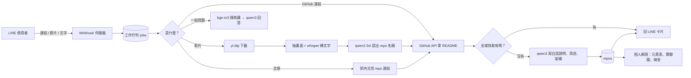

# SolGeGoodShxt

**滑到開源專案，丟給 LINE，本機 AI 幫你看懂它、想出用途、畫出架構。**

📚 目前的知識庫（公開網頁）：<https://kaikai0database.github.io/SolGeGoodShxt/>

這個 repo 放的是「模式與想法」：它怎麼運作、為什麼這樣設計。打包好的程式和金鑰不在這裡。

---

## 想解決的問題

每天在 IG Reels、YouTube、TikTok、Threads 上滑到很多「這個 GitHub 專案超猛」的影片。
當下覺得有用，過兩天就忘了它叫什麼、能拿來幹嘛。

SolGeGoodShxt 的做法：

1. 看到就丟給 LINE bot（連結、影片、文章都可以）。
2. bot 自己認出是哪個 repo。
3. 用白話說明它能做什麼、適合誰、可以怎麼賺錢。
4. 畫一張架構圖。
5. 存進你的個人知識庫，之後可以搜尋、問問題、拿兩三個 repo 做「A+B 煉金」，生出產品點子和 PRD。

## 全部在本機跑，不用付費服務

| 用途 | 工具 |
|---|---|
| 文字理解、白話說明、PRD | Ollama `qwen3:8b` |
| 看影片畫面認 repo 名稱 | Ollama `qwen2.5vl:7b` |
| 語意搜尋、找搭配 | Ollama `bge-m3`（embedding） |
| 影片口白轉文字 | faster-whisper `small`（CPU） |
| 下載影片 | yt-dlp + ffmpeg |
| 對外網址（給 LINE webhook） | Tailscale Funnel，沒開就用 cloudflared |

一台有 8GB 顯卡的電腦（例如 4060Ti）就跑得動，分析一個新 repo 約 30 秒。

## 流程



### 回覆順序（省錢設計）

LINE 免費方案每月只有 200 則主動推播。所以：

1. 45 秒內分析完 → 用免費的 reply 回。
2. 來不及 → 用 push（額度用完只會失敗，不會扣錢）。
3. push 也用完 → 結果先存起來，使用者打 `/結果` 再拿。

### 全域快取

同一個 repo 只分析一次。README 沒變（比對 hash）就直接用舊結果，第二次幾乎是秒回。

## LINE 上的用法

| 你傳的 | bot 做的 |
|---|---|
| GitHub 連結、`owner/repo`、影片或文章連結（一次最多 3 個） | 回 repo 卡片 |
| 其他文字，例如「哪些可以做 LINE 客服？」 | 根據你的收藏回答 |
| `網址` / `換網址` | 個人網頁連結 / 讓舊連結失效 |
| `/列表`、`/刪除 3`、`/結果`、`/說明` | 指令 |

## 資料長什麼樣

```text
repos    每個 repo 一筆（全域共用）：名稱、星星、語言、白話摘要、適合對象、
         用途清單、架構節點、mermaid 圖、embedding
items    使用者收藏了哪些 repo、從哪裡收藏的
alchemy  A+B 煉金結果：標題、一句話賣點、對象、怎麼做、架構圖、PRD
users    LINE 使用者與個人網頁 token
jobs     工作佇列（含 reply token、重試次數）
```

公開網頁只用到 `repos` 和 `alchemy` 的白名單欄位，見 [`tools/export_pages.py`](tools/export_pages.py)。

## 安全與隱私的設計

- 只有 `ALLOWED_USER_IDS` 裡的 LINE 帳號能用，其他人加好友也沒反應。
- 個人網頁用隨機 token 當網址，打 `換網址` 就讓舊連結失效。
- GitHub token 只給 public repo 唯讀權限。
- 金鑰全放在本機 `.env`，不進版控。範本見 [`.env.example`](.env.example)。

## 更新公開網頁

```powershell
python tools/export_pages.py <你的 solge.db 路徑>
git add docs/data.json
git commit -m "更新知識庫"
git push
```

GitHub Pages 會在一兩分鐘內更新，網址不變。

## 還沒做的

- 沙盒試跑 repo
- IG、Threads 的直接入口
- 配額與金流
- 圖卡匯出

## 授權

MIT。想法隨便拿去用。
